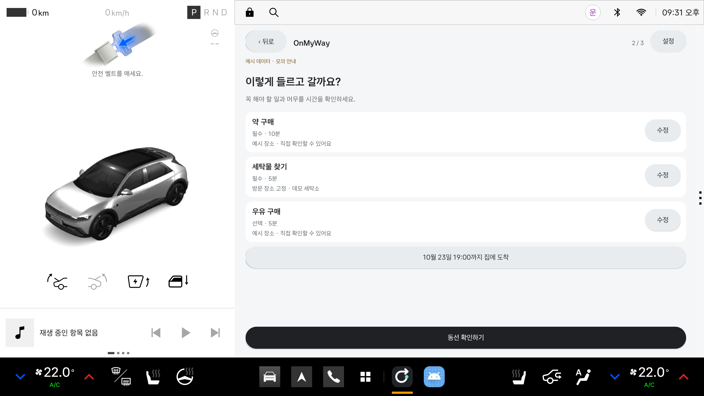
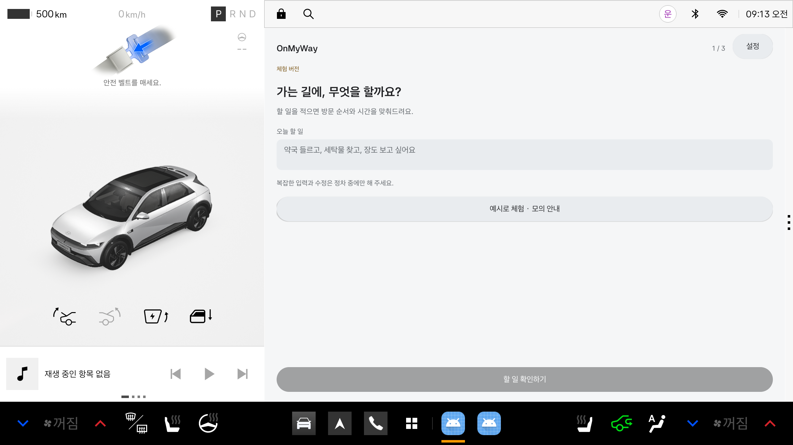
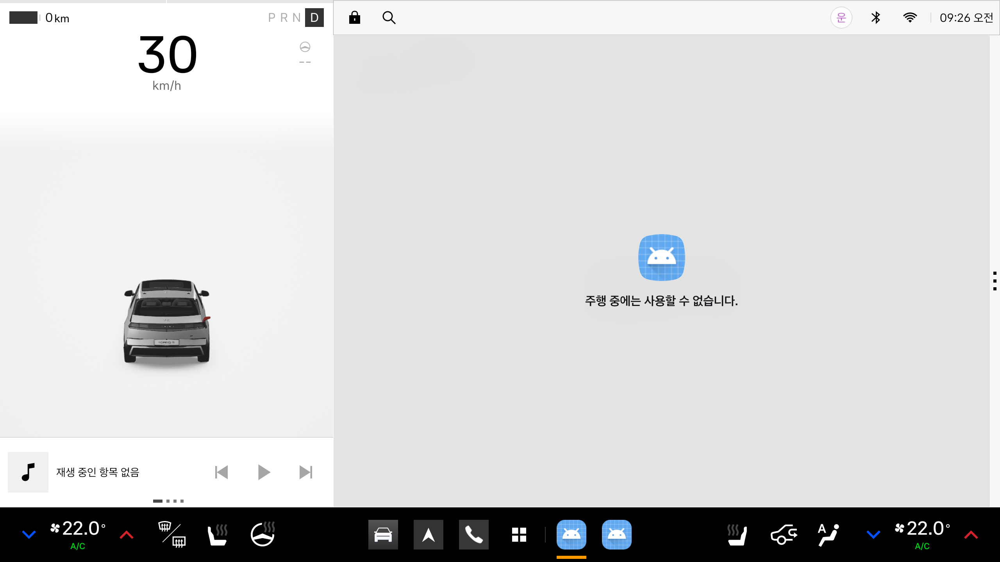
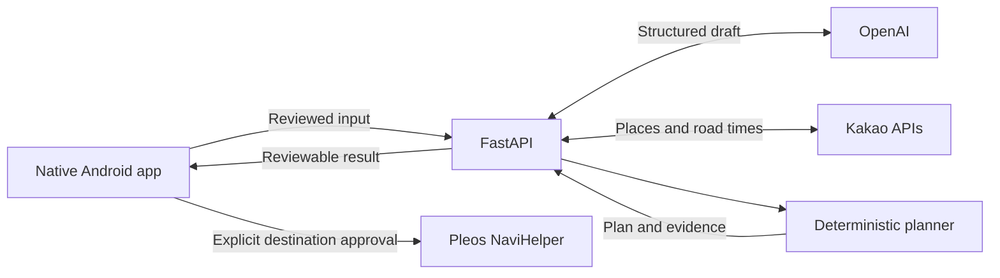
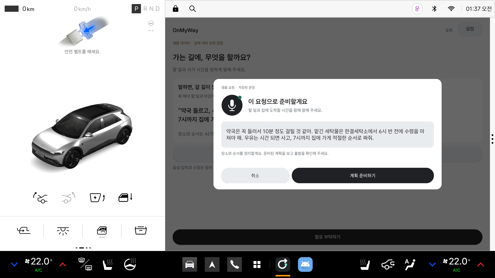

# OnMyWay AI

**Your errands, one smart drive.**

A native **Pleos Connect** app that turns an errand list into a reviewed driving
plan, accounting for road travel, opening waits, time at each stop and the
deadline for getting home.

[Try the demo](#try-the-demo) · [Run locally](#run-locally) ·
[Architecture](#architecture) · [Verification](#verification) ·
[Submission readiness](docs/readiness.md)

Current contest positioning and honest differentiation:
[Korean strategy](docs/contest-strategy-ko.md). Presenter/recovery instructions:
[demo guide](docs/demo-guide-ko.md), [five-minute pitch and Q&A](docs/submission/pitch-and-demo-ko.md).
[2026-10-28 briefing review](docs/submission/briefing-review-ko.md) maps timestamped
organizer guidance to current evidence, technical Q&A and remaining priorities.
The latest [Pleos film and viral Short](docs/submission/final-films-ko.md)
use actual official Pleos AVD screen recordings of an installed native `film`
flavor: a 133.5-second product story and a 50-second original quest/milk comedy,
with timed ElevenLabs editorial speech and music. Open
`artifacts/final-films/pleos/player.html` locally. The film package is an isolated
authored prototype; it does not prove live providers or production navigation.
The earlier illustrated-screen edit was rejected and is superseded.
See [media verification](docs/submission/final-films-verification.json).

The earlier recorded story film follows one natural-language request, automatic route
preparation and a spoken 30-minute pharmacy refinement, preserving mandatory
pickup, optional milk omission and separately approved home. Every native chapter
shows the **full Pleos surface including the left vehicle panel**. See the [Korean scenario](docs/submission/story-demo-ko.md)
and [local production instructions](scripts/STORY_DEMO.md). Video/audio stay local;
selected [actual service-cockpit frames](docs/screenshots/pleos-cockpit/README.md) provide review evidence.
The previous silent film and HTML pitch are historical; readiness records their scope.
A historical [silent vertical motion Short](docs/submission/shortform-ko.md) remains available;
it uses earlier footage and has its own verification scope.

> **Current status:** The native app, deterministic planner and explicitly
> labelled demo flow have been verified on the official Pleos emulator.
> Live OpenAI/Kakao calls and actual navigation acceptance/arrival still require
> separate verification. Screens below use **example data and simulated guidance**.



*Actual signed-demo capture on Pleos Connect 2.1.0, API 34. Errands, selected venues, opening windows and road times are explicit synthetic fixtures; guidance is simulated.*

## The problem

An errand route has more constraints than a list of destinations. A pharmacy may
close before a laundry pickup; each stop takes time; getting to the shop is only
part of finishing the task. The final drive home must fit too.

OnMyWay lets the user review those constraints before approving a destination.
AI produces an editable draft. A deterministic planner evaluates the supplied
times and evidence, and the native app guides one step at a time.

Example request:

> “약국 들르고, 세탁물 찾고, 우유도 사서 7시 전에 집에 가야 해.”

Natural-language parsing uses the configured server-side provider. The key-free
demo is requested separately and does not claim to parse this example live.

## The vehicle experience

| Step | What the user does | What the app preserves |
| --- | --- | --- |
| Enter | Type errands, or explicitly select the example | Example data and simulated guidance stay labelled |
| Review | Check required tasks, dwell times and home deadline | Edits invalidate the previous plan and approval |
| Plan | Inspect the next stop and expected home arrival | Road travel, opening wait, dwell and final home leg count |
| Approve | Confirm the current next destination | Approval belongs to the fresh current plan |
| Complete | Confirm that the errand is actually finished | Arrival alone never completes a task |
| Continue | Recalculate remaining errands, then approve home separately | Required errands are never silently removed |

The UI uses native Android Views, large text and 80dp primary controls. It follows
system day/night mode and keeps one main action visible. Server configuration,
coordinates and evidence details sit behind secondary actions. Actual vehicle
restrictions lock editing and destination approval; unavailable vehicle state
fails closed in the live variant.

<details>
<summary>More actual Pleos screens: input, review, night mode and driving lock</summary>

| Input | Review |
| --- | --- |
|  |  |

| Night mode | Actual driving restriction |
| --- | --- |
|  |  |

The driving-lock capture used the official Virtual Console at Drive / 30 km/h.
The isolated emulator was restored to Park / 0 afterward.
[Capture provenance and the previous UI](docs/screenshots/automotive-ux/README.md).

</details>

## Architecture



The API never starts navigation. The Android app owns vehicle restrictions,
destination approval, arrival handling and explicit completion. The planner
makes no network calls and never delegates route arithmetic to the language model.

| Area | Implementation |
| --- | --- |
| Vehicle app | Kotlin, Android Views, separate `demo` / `live` variants |
| Vehicle integration | Pleos NaviHelper 3.0.5 and native CarUxRestrictions |
| Backend | Python 3.11+, FastAPI, Pydantic 2, HTTPX |
| Planning | Exhaustive search across supplied candidate choices, stop orders and optional subsets |
| Contracts | Checked-in OpenAPI schema and example request/response payloads |
| Storage | Stateless API; local Android drafts and completed task IDs; no database |

The planner accepts up to five errands and three supplied candidates per errand.
The native live flow first searches up to **three nearby places** and requires
the user to select the exact venue for each errand. Selected venues remain fixed
through discovery and replanning; legacy API requests without a selection still
use one nearby result. Search results do not establish availability.
Unknown opening hours, service availability or required road data cannot establish
feasibility. Results distinguish `feasible`, `needs_verification` and
`infeasible`; optional omissions and mandatory failures have explicit reasons.
A deadline-extension suggestion never changes the user's input automatically.

The venue editor records an explicitly entered availability window, confirmation
basis and time. Missing, future or older-than-24-hour live confirmation remains
unverified. Current-traffic snapshots remain warnings even after venue review.
An uncertain deadline proposal stays conditional and never upgrades feasibility.
Android counts computation and review time against the tightest known deadline
before destination approval. After explicit completion it automatically refreshes
the preview, retaining the selected venues and requiring a new destination approval.

Navigation requests have a bounded acceptance wait and explicit cancellation/
reconnection recovery. Local teardown invalidates callbacks without explicitly
cancelling accepted guidance; actual SDK route preservation and same-name callback
behavior still need live verification.

### Repository layout

| Path | Purpose |
| --- | --- |
| [apps/automotive](apps/automotive/README.md) | Native UI, journey state, vehicle restrictions and navigation |
| [services/api](services/api/README.md) | Intent extraction, provider adapters, planning and API tests |
| [contracts](contracts/README.md) | Shared API schema and representative payloads |
| [scripts](scripts) | Local setup, builds, actual-emulator checks and packaging |
| [docs/screenshots](docs/screenshots/automotive-ux/README.md) | Authorized actual UI captures and provenance |
| [docs/submission](docs/submission/README.md) | Korean application draft, pitch and submission checklist |

## Run locally

Commands below run from the repository root in **Windows PowerShell**.

Prerequisites: Python 3.11+; JDK 17; Android SDK Platform 35 and Build Tools
35.0.0. Gradle 8.9 is included through the wrapper. Pleos runtime checks require
the official Pleos Connect 2.1.0 x86_64 API 34 emulator, with a cold boot.
Install the SDKs under their respective licenses before building.

### Start the API

```powershell
./scripts/setup-api.ps1
./scripts/start-api.ps1
```

The launcher creates an ignored root `.env` from `.env.example` if absent,
preserves existing configuration, and binds to `127.0.0.1:8000`.
Open [API documentation](http://127.0.0.1:8000/docs) or check
[health](http://127.0.0.1:8000/health). The demo and planner work without provider
keys. Health reports configuration booleans, never secret values.

### Build and launch Android

Set the paths to your installed tools:

```powershell
$env:JAVA_HOME = 'C:/path/to/jdk17'
$env:ANDROID_HOME = 'C:/path/to/android-sdk'
./apps/automotive/gradlew.bat -p apps/automotive testDemoDebugUnitTest assembleDemoDebug assembleLiveDebug
```

Install the demo on an isolated Pleos emulator. Replace the device serial below
with yours, as listed by `adb devices`:

```powershell
$device = 'emulator-5556'
$adb = Join-Path $env:ANDROID_HOME 'platform-tools/adb.exe'
& $adb -s $device install -r apps/automotive/app/build/outputs/apk/demo/debug/app-demo-debug.apk
& $adb -s $device shell am start --user current -n ai.onmyway.car.demo/ai.onmyway.car.MainActivity
```

The default app server is `http://10.0.2.2:8000`, the emulator's host address.
Alternatively, run `adb -s <serial> reverse tcp:8000 tcp:8000` and set the app
server to `http://127.0.0.1:8000` through **설정 → 연결 · 위치 고급 설정**.

The demo package is `ai.onmyway.car.demo`; the live package is `ai.onmyway.car`.
Only demo exposes fixture requests and simulated guidance. A live provider
failure produces an explicit error and never silently switches to examples.

See the [Android guide](apps/automotive/README.md) for additional checks.
The optional [release build script](scripts/build-android.ps1) expects the local
SDK under `.tools/android-sdk` and can create an ignored development signing key
with `-Release -GenerateSigningKey`. Preserve that private key for compatible
updates. APKs are generated locally and are absent from a fresh clone.

### Try the demo

With the API running and the demo app open while parked:

1. Tap **예시로 체험 · 모의 안내** to request the labelled sample.
2. Review the three errands. Change the pharmacy dwell from 10 to 15 minutes
   using **수정 → + 5분 → 저장**.
3. Tap **동선 확인하기**. The sample predicts home arrival at **18:45** against
   its **19:00** deadline.
4. Tap **이곳으로 안내 → 목적지 승인**, then send **도착 체험 · 모의 이벤트**.
   Arrival leaves the errand unfinished.
5. Use **할 일 완료 → 완료했어요**. The remaining preview refreshes automatically;
   approve its next destination separately.
6. Finish the remaining stops and approve **집으로 안내** separately.

The repeatable fixture uses **2026-10-23**. Its dates, places and timings are
demonstration inputs, not a current driving recommendation.

**마감·미확인 정보 체험 · 예시** independently requests an uncertain, synthetic
deadline-conflict case. Its 18:31/+11-minute proposal remains conditional, and the
updated route shows unknown availability, zero margin and the omitted optional
purchase. No failed live request selects this example.

Reproducible synthetic comparisons and the unperformed user-observation protocol:
[evaluation guide](docs/evaluation-guide.md) ·
[Korean study cards](docs/submission/user-study-ko.md).

### Voice input

For the current key-free native demo, run `scripts/start-demo.ps1`, then choose
**질문과 답변 체험 · 예시 해석**. One primary action guides clarification, explicit
home-time selection and planning. Original text and answers remain reviewable;
plan explanations use the solver's actual times and uncertainty.

[Korean presenter and recovery guide](docs/demo-guide-ko.md).
Prepared interpretation and simulated navigation are labelled; no live model
result is claimed by this example.

While actually parked, **말로 부탁하기** starts Pleos on-device Korean speech
recognition. A final transcript automatically starts interpretation and route
preparation. Missing conditions can be answered by speech; generic flexible shops
are proposed automatically, while exact pickup venues require confirmation.
The compact summary shows ordered venues, dwell/completion deadlines and home ETA. Original text, answers and detailed evidence stay under **요청 · 일정 자세히**. Live and sample use the same main labels/layout; only a small source badge distinguishes synthetic data. Simulation event utilities live in settings.
Explicit spoken departure or **확인하고 출발** approves only the current fresh
next destination; interpretation alone never starts navigation. Cancel, background and driving restrictions stop the
speech session and release the microphone.

For a key-free presentation, explicitly choose **설정 → 샘플로 둘러보기**, then use the same **말로 부탁하기** action.
The real native orchestration and solver prepare the labelled fixture journey.
**말로 조건 바꾸기** applies a clearly identified saved refinement in sample mode
and recalculates automatically. These are prepared texts with simulated navigation,
not live STT or LLM interpretation. Successful final Korean transcription remains
unverified. Exact location setup is still required before a live journey.



[Voice verification and reproduction](apps/automotive/README.md#voice-input-demo)
· [Actual day/night and driving-lock captures](docs/screenshots/voice-input/README.md)

### Configure live providers later

Edit only the ignored server-side `.env`, then restart the API:

| Variable | Used by |
| --- | --- |
| `OPENAI_API_KEY` | Natural-language interpretation |
| `OPENAI_MODEL` | Explicit model selection; no model is chosen silently |
| `KAKAO_REST_API_KEY` | Nearby place discovery |
| `KAKAO_MOBILITY_REST_API_KEY` | Directed road travel times |

Keys never belong in Android source, APKs, screenshots or checked-in files.
Empty configuration produces explicit errors on the relevant live endpoint.
The development API has no user authentication and binds only to localhost.

[API behavior, endpoints and provider limits](services/api/README.md) ·
[Environment template](.env.example)

## Verification

The following are **recorded results from 2026-10-25**, not claims of live service
validation. Exact commands, revisions and caveats are in the
[delivery ledger](docs/progress.md).

| Check | Recorded evidence |
| --- | --- |
| Backend | 67 Python tests passed; provider HTTP mocked, including venue identity, availability evidence and conditional proposals |
| Android | 106 unit tests per variant passed, including venue review, elapsed deadline slack, request ownership/timeout and approval/completion boundaries |
| Builds | Demo/live debug and signed release builds passed; release v3 signatures verified |
| Actual Pleos demo | Pinned example pickup → HTTP plan → arrival stays incomplete → three explicit completions with automatic previews → separately approved simulated home |
| Actual vehicle restrictions | Drive / 30 km/h locked actions and dismissed an open editor; Park / 0 restored |
| UI | Actual day/night captures and native date/reset checks |
| CI | The current PR reports its remote checks separately; local final commands include both variants and lint. [Workflow](.github/workflows/verify.yml) |

Reproduce application checks after toolchain setup:

```powershell
./.venv/Scripts/python.exe -m pytest services/api/tests -q
./apps/automotive/gradlew.bat -p apps/automotive testDemoDebugUnitTest assembleDemoDebug assembleLiveDebug
```

### Remaining validation

Live OpenAI/Kakao authentication, real place/road results, actual Pleos route
acceptance and arrival, and physical-vehicle usability remain unverified.
Current Kakao keyword results do not establish opening hours or service
availability; current-traffic durations are snapshots rather than forecasts.
Pleos ON_DEVICE voice input is implemented, with automatic final-transcript
submission and an independent, labelled example-conversation demo. Actual SDK initialization,
listening readiness, cancellation, background cleanup and bounded no-audio failure
have been checked on the emulator. Successful final Korean transcription remains
unverified. Pleos ON_DEVICE Korean plan output has been implemented and actually
recorded on the official AVD. Spoken refinement and explicit departure/home
approval use the same guarded native flow. Successful real Korean recognition
and live provider/navigation results still require validation. Native setup now
uses fresh Pleos vehicle location with explicit departure/home confirmation and
optional keyword-place selection; manual entry remains an explicit fallback.
[Location behavior and actual AVD evidence](docs/location-setup.md) ·
[spoken conversation](docs/spoken-conversation.md).

No measured time savings, current users or retention results are claimed.
[Current readiness and next verification steps](docs/readiness.md).

## Evidence and contest materials

The current local film is **164.36 seconds, FHD, constant30fps**, with actual
Pleos ON_DEVICE plan speech and offline prepared user dialogue. It shows spoken
refinement, guarded spoken departure and separately approved home navigation.
Every native scene includes the full Pleos vehicle/app surface. Captions are
authored summaries and prepared-dialogue sentence cues. See [current evidence](docs/screenshots/spoken-plan/README.md)
and [local production](scripts/SPOKEN_DEMO.md). Earlier editorial-narration and silent
captures are historical. Videos, raw captures, APKs, office documents and
archives stay local; authorized screenshots and the historical small
[Korean SRT](artifacts/evidence/OnMyWay_AI_Pleos_new_ui_demo.srt) are versioned.
[Recording provenance and local file names](artifacts/evidence/README.md).

| Material | Location |
| --- | --- |
| Product and engineering specification | [docs/spec.md](docs/spec.md) |
| Korean application draft | [docs/submission/application-ko.md](docs/submission/application-ko.md) |
| Pitch and demo script | [docs/submission/pitch-and-demo-ko.md](docs/submission/pitch-and-demo-ko.md) |
| Submission checklist | [docs/submission/checklist-ko.md](docs/submission/checklist-ko.md) |

Contest materials remain working drafts. The older office/pitch files and local
review ZIP predate the new UI and need regeneration before sharing. Keep project
materials anonymous; identity and signatures belong in the operational form.
Repository access grants, public publication and final email submission require
the owner's authorization.


## Native navigation screen

Approved live routes now request the official Pleos Navigation screen after actual
route acceptance, with explicit parked retry and interrupted-guidance recovery.
Synthetic/simulated routes never open native navigation. Actual SDK foreground
and recovery-button dispatch were verified on the official AVD. Its native tile
server returned HTTP401 and the map canvas was blank; successful tile rendering,
live planned-route acceptance and actual arrival remain unverified. No additional
provider keys were used. [Flow, safety boundaries and evidence](docs/navigation-handoff.md).
