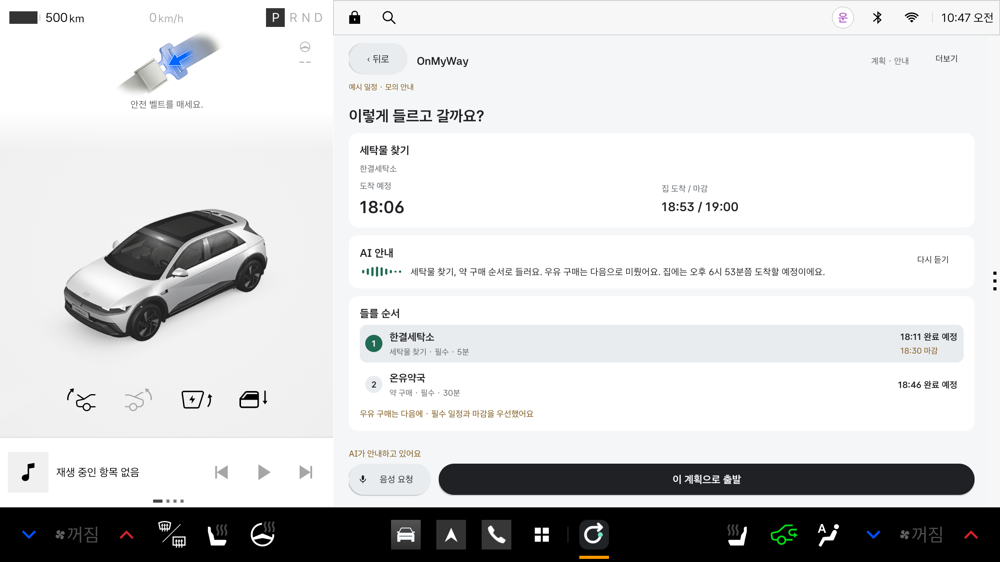
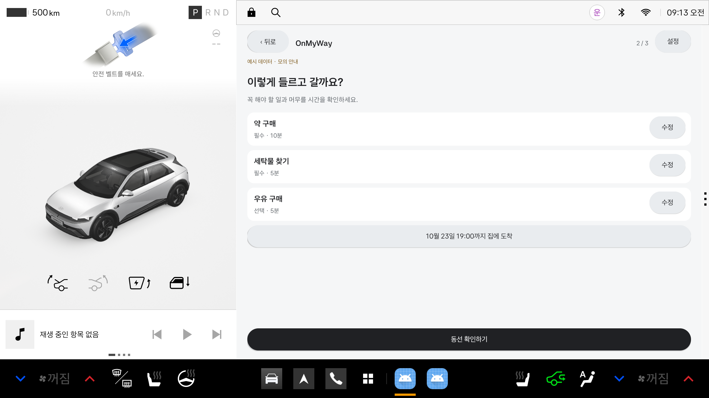
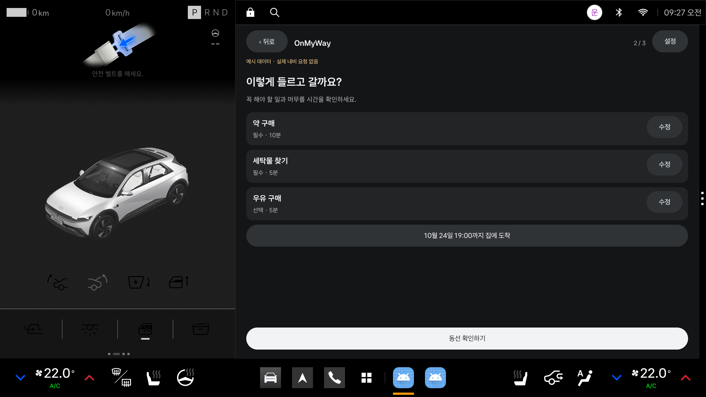
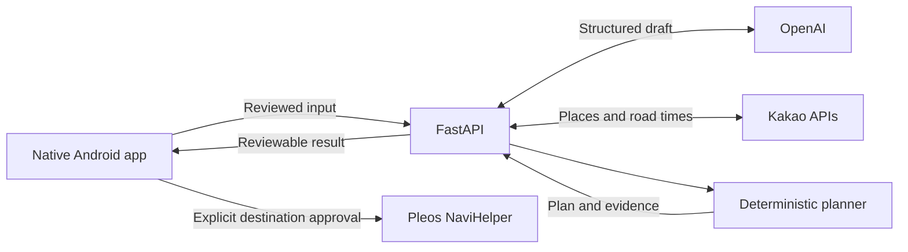

# OnMyWay AI

**Voice-first errand planning for Pleos Connect**

Tell OnMyWay what you need to do and when you need to be home. It proposes a stop
order around pickup deadlines, opening waits, travel time and time at each stop.
When a stop takes longer, review the updated plan before approving where to go next.

[Watch the demo](https://youtu.be/-e3DBmSvgQM) · [Watch the Short](https://www.youtube.com/shorts/s-mTWmpmE74) · [Run locally](#run-locally) · [Architecture](#architecture) · [Verification](#verification)

[](https://youtu.be/-e3DBmSvgQM)

*Signed demo APK running on Pleos Connect 2.1.0. The screen shows a labelled
example itinerary and simulated guidance. Select the image to watch the walkthrough.*

## Watch OnMyWay in action

| Video | What you'll see |
| --- | --- |
| [**Pleos Connect walkthrough** · 1:44](https://youtu.be/-e3DBmSvgQM) | The pharmacy visit grows from 10 to 30 minutes. OnMyWay moves laundry pickup first, defers an optional stop and estimates arrival home at 18:53. |
| [**“여보, 퇴근했어?”** · 0:42](https://www.youtube.com/shorts/s-mTWmpmE74) | One phone call, two errands and a deadline. A short skit with the app running on the Pleos emulator. |

The walkthrough uses prepared requests, example locations and travel times, and
simulated arrivals. It also includes a separate route shown in the built-in Pleos
navigation app. See [recording provenance](docs/submission/final-films-ko.md) and
[verification scope](#verification).

## The problem

An errand route has more constraints than a list of destinations. A pharmacy may
close before a laundry pickup; each stop takes time; getting to the shop is only
part of finishing the task. The final drive home must fit too.

OnMyWay lets the user review those constraints before approving a destination.
AI produces an editable draft. A deterministic planner evaluates the supplied
times and evidence, and the native app guides one step at a time.

Example request

> “약국 들르고, 세탁물 찾고, 우유도 사서 7시 전에 집에 가야 해.”

Natural-language parsing uses the configured server-side provider. The key-free
demo is requested separately and does not claim to parse this example live.

## The vehicle experience

| Step | What the user does | What the app preserves |
| --- | --- | --- |
| Enter | Type errands, or explicitly select the example | Example data and simulated guidance stay labelled |
| Review | Check required tasks, dwell times and home deadline | Edits invalidate the previous plan and approval |
| Plan | Inspect the next stop and expected home arrival | Road travel, opening wait, dwell and final home leg count |
| Approve | Confirm the current next destination | Approval belongs to the fresh current plan |
| Complete | Confirm that the errand is actually finished | Arrival alone never completes a task |
| Continue | Recalculate remaining errands, then approve home separately | Required errands are never silently removed |

The UI uses native Android Views, large text and 80dp primary controls. It follows
system day/night mode and keeps one main action visible. Server configuration,
coordinates and evidence details sit behind secondary actions. Actual vehicle
restrictions lock editing and destination approval; unavailable vehicle state
fails closed in the live variant.

<details>
<summary>More actual Pleos screens: input, review, night mode and driving lock</summary>

| Input | Review |
| --- | --- |
|  |  |

| Night mode | Actual driving restriction |
| --- | --- |
|  |  |

The driving-lock capture used the official Virtual Console at Drive / 30 km/h.
The isolated emulator was restored to Park / 0 afterward.
[Capture provenance and the previous UI](docs/screenshots/automotive-ux/README.md).

</details>

## Architecture



The API never starts navigation. The Android app owns vehicle restrictions,
destination approval, arrival handling and explicit completion. The planner
makes no network calls and never delegates route arithmetic to the language model.

| Area | Implementation |
| --- | --- |
| Vehicle app | Kotlin, Android Views, separate `demo` / `live` variants |
| Vehicle integration | Pleos NaviHelper 3.0.5 and native CarUxRestrictions |
| Backend | Python 3.11+, FastAPI, Pydantic 2, HTTPX |
| Planning | Exhaustive search across supplied candidate choices, stop orders and optional subsets |
| Contracts | Checked-in OpenAPI schema and example request/response payloads |
| Storage | Stateless API; local Android drafts and completed task IDs; no database |

The planner accepts up to five errands and three supplied candidates per errand.
The native live flow first searches up to **three nearby places** and requires
the user to select the exact venue for each errand. Selected venues remain fixed
through discovery and replanning; legacy API requests without a selection still
use one nearby result. Search results do not establish availability.
Unknown opening hours, service availability or required road data cannot establish
feasibility. Results distinguish `feasible`, `needs_verification` and
`infeasible`; optional omissions and mandatory failures have explicit reasons.
A deadline-extension suggestion never changes the user's input automatically.

The venue editor records an explicitly entered availability window, confirmation
basis and time. Missing, future or older-than-24-hour live confirmation remains
unverified. Current-traffic snapshots remain warnings even after venue review.
An uncertain deadline proposal stays conditional and never upgrades feasibility.
Android counts computation and review time against the tightest known deadline
before destination approval. After explicit completion it automatically refreshes
the preview, retaining the selected venues and requiring a new destination approval.

Navigation requests have a bounded acceptance wait and explicit cancellation/
reconnection recovery. Local teardown invalidates callbacks without explicitly
cancelling accepted guidance; actual SDK route preservation and same-name callback
behavior still need live verification.

### Repository layout

| Path | Purpose |
| --- | --- |
| [apps/automotive](apps/automotive/README.md) | Native UI, journey state, vehicle restrictions and navigation |
| [services/api](services/api/README.md) | Intent extraction, provider adapters, planning and API tests |
| [contracts](contracts/README.md) | Shared API schema and representative payloads |
| [scripts](scripts) | Local setup, builds, actual-emulator checks and packaging |
| [docs/screenshots](docs/screenshots/automotive-ux/README.md) | Authorized actual UI captures and provenance |
| [docs/submission](docs/submission/README.md) | Korean application draft, pitch and submission checklist |

## Run locally

Commands below run from the repository root in **Windows PowerShell**.

Prerequisites: Python 3.11+; JDK 17; Android SDK Platform 35 and Build Tools
35.0.0. Gradle 8.9 is included through the wrapper. Pleos runtime checks require
the official Pleos Connect 2.1.0 x86_64 API 34 emulator, with a cold boot.
Install the SDKs under their respective licenses before building.

### Start the API

```powershell
./scripts/setup-api.ps1
./scripts/start-api.ps1
```

The launcher creates an ignored root `.env` from `.env.example` if absent,
preserves existing configuration, and binds to `127.0.0.1:8000`.
Open [API documentation](http://127.0.0.1:8000/docs) or check
[health](http://127.0.0.1:8000/health). The demo and planner work without provider
keys. Health reports configuration booleans, never secret values.

### Build and launch Android

Set the paths to your installed tools:

```powershell
$env:JAVA_HOME = 'C:/path/to/jdk17'
$env:ANDROID_HOME = 'C:/path/to/android-sdk'
./apps/automotive/gradlew.bat -p apps/automotive testDemoDebugUnitTest assembleDemoDebug assembleLiveDebug
```

Install the demo on an isolated Pleos emulator. Replace the device serial below
with yours, as listed by `adb devices`:

```powershell
$device = 'emulator-5556'
$adb = Join-Path $env:ANDROID_HOME 'platform-tools/adb.exe'
& $adb -s $device install -r apps/automotive/app/build/outputs/apk/demo/debug/app-demo-debug.apk
& $adb -s $device shell am start --user current -n ai.onmyway.car.demo/ai.onmyway.car.MainActivity
```

The default app server is `http://10.0.2.2:8000`, the emulator's host address.
Alternatively, run `adb -s <serial> reverse tcp:8000 tcp:8000` and set the app
server to `http://127.0.0.1:8000` through **설정 → 연결 · 위치 고급 설정**.

The demo package is `ai.onmyway.car.demo`; the live package is `ai.onmyway.car`.
Only demo exposes fixture requests and simulated guidance. A live provider
failure produces an explicit error and never silently switches to examples.

See the [Android guide](apps/automotive/README.md) for additional checks.
The optional [release build script](scripts/build-android.ps1) expects the local
SDK under `.tools/android-sdk` and can create an ignored development signing key
with `-Release -GenerateSigningKey`. Preserve that private key for compatible
updates. APKs are generated locally and are absent from a fresh clone.

### Try the demo

Start the local API and open the demo APK while parked. Leave external provider
keys empty to run this example.

1. Choose **설정 → 샘플로 둘러보기**, then **돌아가기**. Tap **말로 부탁하기** and
   **계획 준비하기**. The initial plan estimates arrival home at **18:40**.
2. Choose **음성 요청 → 약국에 머무를 시간 변경 → 말 전달하기**. The revised plan
   puts laundry pickup before the pharmacy and estimates arrival home at **18:53**.
3. Tap **이 계획으로 출발**. Open **이동 현황 보기** to check the destination and
   the planned times.
4. For the simulated arrival, use **더보기 → 설정 → 샘플 안내 · 도착 신호**.
   Tap **완료했어요** after the errand is complete. The app prepares the next stop.
5. Complete the remaining errand, then approve **집으로 안내 시작** separately.

The [evaluation guide](docs/evaluation-guide.md) describes the repeatable examples
and the [Korean study cards](docs/submission/user-study-ko.md) describe the
proposed user-observation protocol.

### Voice input

While actually parked, **말로 부탁하기** starts Pleos on-device Korean speech
recognition. A final transcript automatically starts interpretation and route
preparation. Missing conditions can be answered by speech; generic flexible shops
are proposed automatically, while exact pickup venues require confirmation.
The compact summary shows stop order, dwell times, completion deadlines and the
home ETA. Open **더보기 → 일정 상세** to review the original request and plan details.
A spoken approval or **이 계획으로 출발** approves the current next destination.
Cancelling, backgrounding the app or entering a driving restriction stops the
speech session and releases the microphone.

The [key-free demo](#try-the-demo) uses explicitly selected prepared utterances
and simulated guidance. Live mode requires the provider settings below and
confirmed departure and home locations. See the
[Korean presenter and recovery guide](docs/demo-guide-ko.md).


[Voice verification and reproduction](apps/automotive/README.md#voice-input-demo)
· [Actual day/night and driving-lock captures](docs/screenshots/voice-input/README.md)

### Configure live providers later

Edit only the ignored server-side `.env`, then restart the API:

| Variable | Used by |
| --- | --- |
| `OPENAI_API_KEY` | Natural-language interpretation |
| `OPENAI_MODEL` | Explicit model selection; no model is chosen silently |
| `KAKAO_REST_API_KEY` | Nearby place discovery |
| `KAKAO_MOBILITY_REST_API_KEY` | Directed road travel times |

Keys never belong in Android source, APKs, screenshots or checked-in files.
Empty configuration produces explicit errors on the relevant live endpoint.
The development API has no user authentication and binds only to localhost.

[API behavior, endpoints and provider limits](services/api/README.md) ·
[Environment template](.env.example)

## Verification

The signed demo built from `main` at `57303e7` was installed and run on Pleos
Connect 2.1.0 (API 34). The [delivery ledger](docs/progress.md) records earlier
checks, including actual Drive / 30 km/h restrictions.

| Check | Recorded evidence |
| --- | --- |
| Backend | 67 tests passed, including provider responses exercised through mocks |
| Android | 119 demo-variant unit tests passed |
| APK | `demoRelease` built and APK Signature Scheme v3 verified |
| Pleos emulator | Initial plan, dwell-time replan, moving overview, separate arrival and completion, next-stop refresh and separately approved simulated home arrival |

Reproduce application checks after toolchain setup:

```powershell
./.venv/Scripts/python.exe -m pytest services/api/tests -q
./apps/automotive/gradlew.bat -p apps/automotive testDemoDebugUnitTest assembleDemoDebug assembleLiveDebug
```

### Remaining validation

Live OpenAI/Kakao authentication, real place/road results, actual Pleos route
acceptance and arrival, and physical-vehicle usability remain unverified.
Current Kakao keyword results do not establish opening hours or service
availability; current-traffic durations are snapshots rather than forecasts.
Pleos ON_DEVICE voice input is implemented, with automatic final-transcript
submission and an independent, labelled example-conversation demo. Actual SDK initialization,
listening readiness, cancellation, background cleanup and bounded no-audio failure
have been checked on the emulator. Successful final Korean transcription remains
unverified. Pleos ON_DEVICE Korean plan output has been implemented and actually
recorded on the official AVD. Spoken refinement and explicit departure/home
approval use the same guarded native flow. Successful real Korean recognition
and live provider/navigation results still require validation. Native setup now
uses fresh Pleos vehicle location with explicit departure/home confirmation and
optional keyword-place selection; manual entry remains an explicit fallback.
[Location behavior and actual AVD evidence](docs/location-setup.md) ·
[spoken conversation](docs/spoken-conversation.md).

No measured time savings, current users or retention results are claimed.
[Current readiness and next verification steps](docs/readiness.md).

## Evidence and contest materials

| Material | Location |
| --- | --- |
| Video production and emulator capture | [Pleos film notes](docs/submission/final-films-ko.md) · [media verification](docs/submission/final-films-verification.json) |
| Earlier native voice-flow capture | [Screenshots and scope](docs/screenshots/spoken-plan/README.md) · [production notes](scripts/SPOKEN_DEMO.md) |
| Product and engineering specification | [docs/spec.md](docs/spec.md) |
| Korean application draft | [docs/submission/application-ko.md](docs/submission/application-ko.md) |
| Pitch and demo script | [docs/submission/pitch-and-demo-ko.md](docs/submission/pitch-and-demo-ko.md) |
| Contest preparation | [Korean strategy](docs/contest-strategy-ko.md) · [briefing review](docs/submission/briefing-review-ko.md) · [submission checklist](docs/submission/checklist-ko.md) |

[Recording provenance and local file names](artifacts/evidence/README.md).

Contest materials remain working drafts. The older office/pitch files and local
review ZIP predate the new UI and need regeneration before sharing. Keep project
materials anonymous; identity and signatures belong in the operational form.
Repository access grants, public publication and final email submission require
the owner's authorization.


## Native navigation screen

Approved live routes now request the official Pleos Navigation screen after actual
route acceptance, with explicit parked retry and interrupted-guidance recovery.
Synthetic/simulated routes never open native navigation. Actual SDK foreground
and recovery-button dispatch were verified on the official AVD. Its native tile
server returned HTTP401 and the map canvas was blank; successful tile rendering,
live planned-route acceptance and actual arrival remain unverified. No additional
provider keys were used. [Flow, safety boundaries and evidence](docs/navigation-handoff.md).
